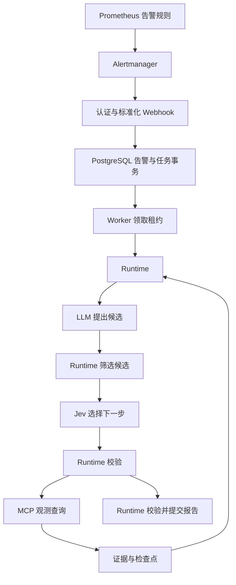

# TracePilot OnCall

Alertmanager 接收与故障诊断使用两个独立进程：API 将告警可靠地转成任务，Worker 从数据库领取任务并驱动原有 LLM + Jev 诊断内核。API 成功应答表示通知已经持久化，查询任务接口获取诊断结果。



## 本地演示

安装 `requirements-tracepilot.txt` 后，在仓库根目录设置：

```bash
export TRACEPILOT_DATABASE_URL=sqlite:///tracepilot-oncall.db
export TRACEPILOT_ALERT_TOKEN=local-demo-alert-token-change-me
export TRACEPILOT_API_TOKEN=local-demo-api-token-change-me

# 终端一：只接收通知和提供查询接口。
python -m tracepilot serve --config examples/tracepilot/oncall.yaml

# 终端二：使用相同环境变量，执行持久化任务。
python -m tracepilot worker --config examples/tracepilot/oncall.yaml
```

第三个终端发送一条告警：

```python
import os
from datetime import datetime, timezone
import requests

payload = {"alerts": [{
    "status": "firing",
    "labels": {"alertname": "CheckoutLatencyHigh", "service": "checkout", "namespace": "demo", "pod": "checkout-a"},
    "annotations": {"summary": "订单接口延迟升高"},
    "startsAt": datetime.now(timezone.utc).isoformat(),
    "fingerprint": "demo-checkout-latency",
}]}
response = requests.post("http://127.0.0.1:8080/api/v1/webhooks/alertmanager/demo",
    headers={"Authorization": "Bearer " + os.environ["TRACEPILOT_ALERT_TOKEN"]}, json=payload, timeout=5)
response.raise_for_status()
print(response.json())
```

保存返回的 task_id，使用 `TRACEPILOT_API_TOKEN` 查询 `GET /api/v1/tasks/{task_id}`。重复发送同一 payload，不会再次创建任务；修改 startsAt 才表示同一告警身份的新一轮发生。

`oncall.yaml` 显式配置 `demo_scenario`，模型和观测均为模拟。此演示用于验证链路、证据引用和恢复行为，不是线上诊断效果数据。没有配置真实模型密钥时不会自动降级为演示。

## 真实接入

使用 `examples/tracepilot/oncall-live.yaml`，将 `TRACEPILOT_DATABASE_URL` 配成 `postgresql+pg8000://...`，配置模型密钥和数据源环境变量；`agent_config` 路径相对 OnCall 配置文件解析。Agent 模型/MCP 配置与[独立运行指南](tracepilot.md)相同，任务预算使用 OnCall source 的 budget。

参考 `examples/tracepilot/alertmanager.yaml` 配置 Webhook、Bearer token 与恢复通知。API 与 Worker 共享数据库，可独立扩容。每个 source 对应固定租户、集群和 MCP 后端配置；HA 副本映射为同一个 source_group。跨服务权限来自 dependencies，跨集群使用独立 source，不能从告警标签或 LLM 输出获得授权。

source 的 services、namespaces 是必填白名单；service_aliases 用于将来源标签映射到逻辑服务，service_label、namespace_label 可配置。缺少映射、无时区时间、无可靠 startsAt 或越界范围会拒绝整批请求，避免调查错误资源。修正来源规则后重新提交。API token 与告警 token 分开配置；不同租户禁止共用同一个 token。

**持久化与调度**

- 在同一事务中写入通知记录、告警发生记录、incident、原有任务检查点与调度记录，提交后返回 202；完整重复返回 200。
- 采用方案中的 PostgreSQL 直接领取路径，不需要 MQ/Redis 才能恢复任务。此实现没有增加 RocketMQ 发布器或 Redis 缓存；后续可在持久化调度边界加入 Outbox 适配。
- PostgreSQL 使用短事务、行锁和 SKIP LOCKED 领取；租约通过递增 lease_epoch、owner 与 lease_until 校验。Worker 持续续租，过期 running 任务可以被其他 Worker 接续。
- SQLite 支持本地演示与单 Worker 测试；多进程生产部署使用 PostgreSQL。
- Schema v1 为增量建表，保留原有 decision_agent_tasks/evidence/events；tracepilot_task_queue 仅保存调度元数据，DecisionState 仍是唯一诊断状态。初始化以 PostgreSQL 事务级锁串行执行，记录 schema version。

API `200/202` 不表示诊断完成。数据库失败返回 503；不使用 FastAPI 内存后台任务代替可靠队列。

**告警语义**

- occurrence 身份由 tenant、source_group、cluster、fingerprint、startsAt 共同确定。不能用 groupKey 作为唯一 incident ID。
- 逐项读取 alerts[].status；组级 status 不会覆盖单条状态。firing 的 endsAt 是变化的过期估计，不会因此创建新任务。
- 同一 occurrence 的 resolved 优先于迟到的 firing；新 startsAt 可以开始新一轮发生。
- 默认按同服务、规则和 Pod 做保守关联，correlation_labels 可配置；超过 correlation_window_seconds 未收到通知的关联范围被标记 stale，不无限合并。
- truncatedAlerts 会保留不完整标记；已知告警都恢复但通知被截断时，incident 标为 unknown，不能据此宣布整个故障恢复。
- 告警恢复只更新 incident，不自动完成诊断。一个 incident 可以有多轮调查，同一时刻只保留一个活跃任务。
- 每个任务使用固定观测时间窗。窗口内上下文在阶段边界合入；更晚的上下文在当前任务结束后创建一次后续调查。报告提交期间新到的上下文也不会丢失。

**恢复与预算**

`DecisionAgent.start/advance/resume/finalize` 复用同一执行内核；旧的 run 仍只接受新状态，历史 CLI 记录不会被静默重放。

工具启动意图先入库，返回后再事务保存观测和状态。结果已经提交的调用不重做；意图存在而结果未知时，仅对操作者声明 retry_safe 的查询有限重试，保留未知尝试且不伪造观测。其他未知结果进入 needs_input。外部调用与数据库不在同一事务，不能承诺外部查询恰好一次。

步骤、工具尝试、推理次数、已报告模型用量、started_at 和 deadline_at 都持久化，恢复不重置。模型/MCP 请求使用剩余截止时间，模型重试不能超出剩余时间；最终报告也检查同一个截止时间。已发出的远程请求只能尽力取消，不能保证供应商停止处理或停止计费。

max_model_tokens 是基于供应商已报告用量的停止门槛，默认关闭。单次在途请求可能超过门槛；超时且未返回 usage 的费用未知。因此它不是严格的预付费 Token/金额上限，不能用它替代供应商的账单限制。模型价格和实际费用应另行核对。

needs_input 不占用 Worker；input_wait_seconds 到期后停止。人工补充不会扩大白名单、授予工具权限或重置原有执行截止时间。需要更长调查窗口时创建新任务。

**受控并行与证据**

max_parallel_tools 默认为 1。启用后，LLM 可以提出 groups：每组包含独立只读候选，Jev 选择 parallel:<id>，Runtime 负责并发。启动前串行预留总工具预算并保存每个 attempt，I/O 并行，结果由协调者串行提交；失败的子查询不抹去成功证据。依赖另一个查询输出的参数必须先后生成。

LLM 可读取较详细观测；Jev 使用最近观测的短预览、来源、覆盖范围、记忆、动作与预算，不重复发送完整工具 Schema/原始日志。旧证据通过 agent_read_evidence 分页读取。

报告的事实、候选原因和 remediation_suggestions 必须引用本任务有效观测；修复建议支持前提、风险和验证步骤。Runtime 生成 summary/outcome。引用存在不能证明推断正确；completed 与根因确认分开，系统不执行自动修复。Jev confidence 表示选项概率的集中程度，不显示为根因正确率。

## API 与验证

| 方法与路径 | 用途 |
| --- | --- |
| POST /api/v1/webhooks/alertmanager/{source_id} | 使用来源 token 接收告警 |
| POST /api/v1/investigations | 使用 API token 人工提交 source_id、scope、question |
| GET /api/v1/incidents/{id} | 查看告警集合、状态与调查任务 |
| GET /api/v1/tasks/{id} | 查看状态、预算、证据摘要与报告 |
| GET /api/v1/tasks/{id}/evidence/{evidence_id} | 按 offset/limit 分页读取原始证据 |
| GET /api/v1/tasks/{id}/events | SSE 已提交事件，支持 Last-Event-ID |
| POST /api/v1/tasks/{id}/resume | 提交 input_text 继续未超期 needs_input 任务 |
| POST /api/v1/tasks/{id}/cancel | 取消任务并使旧租约失效 |
| GET /api/v1/metrics | 当前租户队列计数、最老待执行时间与已接收通知数 |

SSE 断线不影响诊断；事件游标是任务内单调递增 revision。`?follow=false` 只读取当前 backlog，便于验证补读。证据和任务读取先校验租户，其他租户的 ID 返回 404。

观测 MCP 增加 service_metric_summary（受控延迟/流量/错误率模板）、service_trace_detail（完整 Trace 按服务、namespace 和时间过滤）和 service_events（先检查当前 Pod 归属，再读取其 UID 的保留事件）。模板使用五分钟 rate 回看，查询起点向后移动五分钟，确保读取不越过任务起点；窗口需长于五分钟。可配置 OBS_HTTP_DURATION_BUCKET、OBS_HTTP_REQUESTS_TOTAL、OBS_HTTP_STATUS_LABEL，并加入 stdio env_names。事件保留有期限，当前 Pod 快照不代表历史状态。

```bash
pip install -r requirements-tracepilot.txt pytest responses pytest-cov
python -m pytest -c tests/tracepilot/pytest.ini --confcutdir=tests/tracepilot \
  tests/tracepilot tests/decision/test_engine.py tests/decision/test_runtime_regressions.py \
  tests/decision/test_store.py tests/decision/test_providers.py \
  --cov=tracepilot --cov-report=term-missing --cov-fail-under=40

# 确定性四场景回归，不调用模型。
python -m tracepilot evaluate --decision scripted --database-url sqlite://

# 以下两个命令调用付费模型；使用相同观测夹具和 Runtime 对照动作选择。
python -m tracepilot evaluate --decision jev --config examples/tracepilot/fixture.yaml
python -m tracepilot evaluate --decision llm --config examples/tracepilot/fixture.yaml
```

PostgreSQL 集成测试需要 HOLMES_TEST_POSTGRES_URL；CI 提供 PostgreSQL 服务，新队列测试使用独立 schema 并清理。测试涵盖重复/乱序告警、并发接入与领取、租约回收、工具前后崩溃、报告提交后的恢复、取消、任务预算、并行部分失败和跨范围拒绝。

evaluate 输出 JSONL，记录任务延迟、调用次数、已报告 Token、证据覆盖与 outcome 匹配。它检查机械合同和模拟数据覆盖，不能代替真实故障标注下的语义根因准确率、成本收益或 MTTR 评测。本次没有自动调用真实付费模型或生产监控服务。
